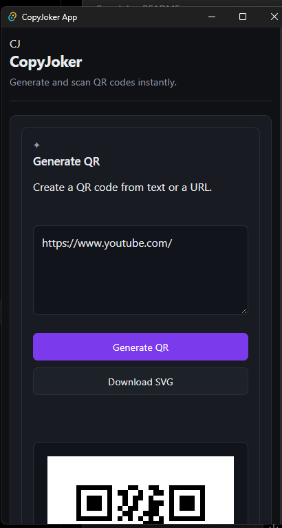
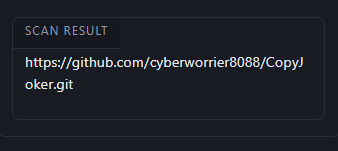

# CopyJoker

A simple and modern QR code generator and scanner.

CopyJoker lets you generate QR code from text or URLs and scan QR codes from images or your device camera

## Description
CopyJoker is a QR code utility built  with Rust, Tauri, HTML, CSS, and JavaScript. The project provides a clean interface for creating QR codes and scanning existing QR codes.

You can generate QR codes from text or URLs, download generated QR codes as SVG files, scan QR codes from PNG, JPG, JPEG, and SVG images, and use your device camera to scan QR codes.

## Features

- Generate QR codes from text or URLs
- Download generated QR codes as SVG
- Scan QR codes from images
- Support for PNG, JPG, JPEG, and SVG files
- Responsive interface for different screen sizes
- Simple and modern UI

## Screenshot

## Getting Started
### Dependencies

Before running CopyJoker, make sure you have the followeing installed